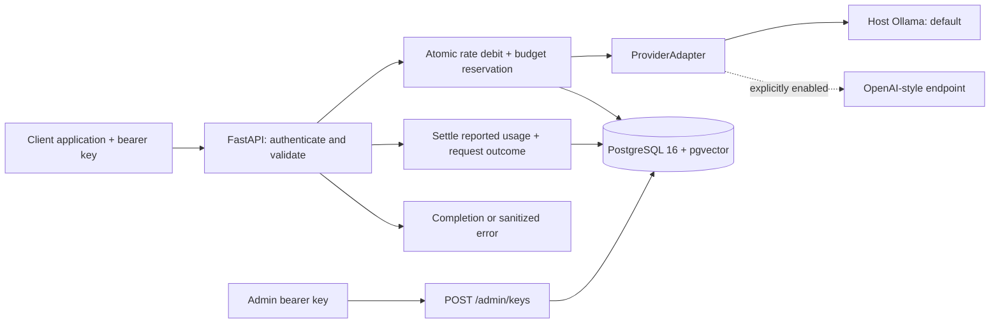

# LLM Gateway

Client applications should not have to implement provider-specific HTTP calls, usage
accounting, caching, routing, and failure handling individually. This project puts
those responsibilities behind a small OpenAI-style API and measures their effect
on latency, hypothetical cost, and answer quality.

**Current milestone: Phase 2 — API keys, request limits, and daily token budgets.**
The core proxy and logging are complete. Semantic caching, routing and fallback,
the evaluation harness, and the dashboard follow in later phases. No model
benchmark results exist yet.

## Architecture



The gateway and database run in Compose. Ollama runs on the host. Model inference
uses local resources and requires no paid API key. `pgvector` is installed by the
first migration; embeddings and vector queries arrive in Phase 3.

## Start locally

Prerequisites: Docker with Compose v2 and host-installed Ollama. Run these commands
from the project directory:

```sh
ollama pull qwen2.5:1.5b
cp .env.example .env
docker compose up
```

Before the last command, replace the password placeholder in both
`POSTGRES_PASSWORD` and `DATABASE_URL` in `.env`, using the same URL-safe password.
Also replace `ADMIN_API_KEY` with an independently generated random credential of
at least 32 characters. The example placeholder is rejected at startup. To
generate a URL-safe random value in Windows PowerShell:

```powershell
$rng = [Security.Cryptography.RandomNumberGenerator]::Create()
$bytes = New-Object byte[] 32
$rng.GetBytes($bytes)
[BitConverter]::ToString($bytes).Replace("-", "").ToLowerInvariant()
$rng.Dispose()
```

This workspace already includes an ignored `.env` with a generated random local
database password and a separate random admin key; you can use it directly without
copying the example over it. `.env` is excluded from Git and Docker builds.

Ollama must be reachable from the container. Its default listen address is
`127.0.0.1`; when needed, set the **host Ollama process** to
`OLLAMA_HOST=0.0.0.0:11434` and restart it. Restrict access to the local Docker
network with your host firewall. The gateway defaults to
`OLLAMA_BASE_URL=http://host.docker.internal:11434`; Compose adds the host mapping
for Linux. See the [Ollama environment-variable instructions](https://docs.ollama.com/faq#how-do-i-configure-ollama-server).

Compose waits for PostgreSQL readiness, applies Alembic migrations, and starts the
gateway. The gateway binds to host loopback at port 8000. Open
[interactive API docs](http://localhost:8000/docs).

Create a client key using the admin credential from `.env` (use `curl.exe` in
Windows PowerShell):

```sh
curl http://localhost:8000/admin/keys -H "Content-Type: application/json" -H "Authorization: Bearer <ADMIN_API_KEY>" --data-binary @examples/create-key.json
```

Save the returned `api_key`; the server stores only its hash and returns the raw
value once. Use that client key for chat requests:

```sh
curl -i http://localhost:8000/v1/chat/completions -H "Content-Type: application/json" -H "Authorization: Bearer <CLIENT_API_KEY>" --data-binary @examples/chat.json
```

`DEFAULT_MODEL` applies when the request omits `model`. Change the example's model
if you pull a different one. Health checks test reachability without inference;
they do not confirm that a requested model has been pulled.

## API

| Route | Behavior |
| --- | --- |
| `POST /v1/chat/completions` | Client bearer key; non-streaming text completion with OpenAI-style `choices` and `usage` |
| `GET /health` | Database and active provider reachability; 503 when degraded |
| `GET /metrics-summary` | Admin bearer key; lifetime request count, reported token totals, and estimated cost |
| `POST /admin/keys` | Admin bearer key; create a client key with per-key RPM and daily token limits |

Accepted generation options: `temperature`, `top_p`, `max_tokens`, `seed`, `stop`,
and `response_format: {"type": "text"\|"json_object"}`. Chat roles are `system`,
`user`, and `assistant`; `n` must be 1 and `stream` must be false. Unsupported or
invalid options return a sanitized OpenAI-style error with HTTP 400. The API is a
documented subset of the OpenAI chat protocol, not a full implementation.

Omitting `max_tokens` applies a finite default of 512 output tokens. Requests above
the configured maximum of 4096 are rejected before inference. In `/docs`, use
**Authorize** with the raw admin or client key appropriate for the endpoint.

Successful completions and provider failures include `X-Request-ID` matching the
database row and `X-Cache: BYPASS`. There is no cache in this phase. Provider
timeouts return 504, other upstream failures return 502, unexpected adapter errors
return 500, and database logging failures return 503. No retry or fallback runs yet.

Missing, unknown, or inactive client keys return 401 with `WWW-Authenticate:
Bearer`. Rate or budget rejections return 429 with a positive integer
`Retry-After` in seconds. Rejected chat requests are logged with a request ID,
including the authenticated key ID when known. Compose exposes only the gateway's
loopback port. Aggregate metrics require the admin key to protect cross-key data.

## Configuration

All settings come from environment variables or `.env`, with environment variables
taking precedence. See `.env.example` for the minimal local setup.

| Setting | Purpose / default |
| --- | --- |
| `DATABASE_URL` | Required async SQLAlchemy URL: `postgresql+asyncpg://...` |
| `OLLAMA_BASE_URL` | `http://host.docker.internal:11434` |
| `DEFAULT_MODEL` | `qwen2.5:1.5b` |
| `PROVIDER_TIMEOUT_SECONDS` | HTTPX timeout per network operation: 120 seconds |
| `HEALTH_TIMEOUT_SECONDS` | Provider health request timeout: 5 seconds |
| `DEFAULT_PROVIDER` | `ollama`, or explicitly enabled `openai_compat` |
| `OPENAI_COMPAT_ENABLED` | `false` |
| `OPENAI_COMPAT_BASE_URL` | Optional endpoint URL including `/v1` |
| `OPENAI_COMPAT_API_KEY` | Optional bearer key; unnecessary for an unauthenticated local endpoint |
| `INPUT_COST_PER_1K`, `OUTPUT_COST_PER_1K` | USD per 1,000 tokens; both default to 0 |
| `ADMIN_API_KEY` | Random admin bearer credential, at least 32 characters; admin routes disabled when unset |
| `DEFAULT_MAX_OUTPUT_TOKENS` | 512 when the request omits `max_tokens` |
| `MAX_OUTPUT_TOKENS` | 4096 maximum accepted output allowance |
| `BUDGET_INPUT_TOKEN_PADDING` | 256 additional tokens reserved for provider prompt templates |

The optional OpenAI-compatible adapter remains disabled by default. Selecting it
requires `OPENAI_COMPAT_ENABLED=true` and a base URL; otherwise startup fails
validation. Everything can run using only Ollama. No external service or key is
required by the tests.

## Rate limits and daily budgets

Every key has its own token bucket: capacity equals `requests_per_minute`, and
tokens refill continuously at `requests_per_minute / 60` per second. It permits
an initial burst up to capacity; it is not a strict sliding-window counter.
Validated completion attempts debit the bucket. Provider failures consume the
request debit, while pre-admission budget rejections do not. Malformed and
unauthenticated requests are logged without an inference debit.

Admission runs inside a short PostgreSQL transaction. It locks the API-key row
with [`SELECT ... FOR UPDATE`](https://www.postgresql.org/docs/16/explicit-locking.html#LOCKING-ROWS),
then reads database wall-clock time, checks the bucket and daily balance, and
commits the request debit, budget hold, and `in_progress` log together. The lock
and connection are released before inference. All workers use the same database
state; there is no process-local rate counter or lock.

The hold reserves UTF-8 prompt bytes + template padding + maximum output tokens.
This conservative input estimate avoids needing a different tokenizer dependency
for each provider. Successful calls reconcile the hold against the provider's
actual input + output token counts. Budget accounting and final log updates are
atomic and settlement is idempotent. `budget_tokens` records the charged allowance;
ordinary token columns record reported usage.

Failed calls with unknown usage retain their reservation. A process crash leaves
an `in_progress` row and a retained hold, rather than refunding potentially consumed
tokens. This favors budget safety over availability; no automatic same-day refund
or recovery endpoint is implemented. Calls finishing after midnight settle their
original day, and calls already admitted still settle if the key is later marked
inactive.

Budgets reset at **00:00 UTC (05:30 India time)** using separate per-key, per-day
rows. Daily-budget `Retry-After` points to the next UTC reset.

An arbitrary provider's hidden tokenizer or prompt template can exceed the input
estimate, or a provider can ignore its output allowance. If reported usage pushes
the charged daily balance over budget, the gateway records all usage, returns
429, and rejects further admissions while the balance exceeds the limit. Thus
concurrent reservations are bounded, but an exact upstream-consumption ceiling
cannot be guaranteed for every opaque provider. Increase padding for unusual
templates; this behavior has a dedicated overrun test.

## Design decisions and tradeoffs

- **Small provider contract.** `generate(prompt, model, params)` and `health()`
  keep provider-specific wire formats in the adapters. The Ollama adapter uses
  [`/api/generate`](https://docs.ollama.com/api/generate) with `stream=false` and
  provider-reported `prompt_eval_count` / `eval_count`. Its health check uses
  [`/api/tags`](https://docs.ollama.com/api/tags). HTTP clients are shared for the
  app lifetime and closed during shutdown.
- **Text transcript.** The requested prompt-based interface flattens messages to
  a role-labeled transcript, followed by an assistant cue. This preserves history
  text but does not guarantee native system-role precedence. The compatible
  adapter sends that transcript as one user message. A native message-based
  contract would improve fidelity if the project later requires it.
- **Commit before inference and responding.** Admission writes a pending row;
  completion updates that same row. Rejections write a separate completed row.
  If admission fails to commit, the rate debit and budget hold roll back and no
  provider call runs. If final accounting fails, return 503 and keep the committed
  hold. Cancellation attempts to finalize its log without refunding unknown usage.
  A forced process exit can leave the row pending.
- **Random client keys.** Keys contain 256 bits of randomness; SHA-256 hashes are
  indexed for lookup. Slow password hashing is unnecessary for random tokens.
  Admin credentials live in `.env`, use constant-time comparison, and cannot be
  used as client keys unless independently registered. Existing Phase 1 logs
  retain nullable key IDs after the Phase 2 migration.
- **No raw prompt logs.** SHA-256 hashes use canonical JSON of the ordered chat
  messages, including roles. Logs store no prompt or response text. These are
  correlation identifiers, not anonymization: low-entropy prompts can be guessed.
- **Separate async sessions.** Each request has its own SQLAlchemy session, in
  line with [SQLAlchemy's concurrency guidance](https://docs.sqlalchemy.org/en/20/orm/extensions/asyncio.html#using-asyncsession-with-concurrent-tasks).
  Requests never share mutable transaction state. Alembic owns schema changes;
  production does not call `create_all()`.
- **Explicit measurement boundaries.** Adapters measure outbound wall-clock
  latency, including transport overhead. The persisted `latency_ms` measures the
  gateway's time through validation, admission, and inference, before the final
  log commit; it excludes final settlement latency and response transfer.
  Phase 5 will measure client-side end-to-end latency separately.
- **Honest usage accounting.** Token counts come from successful provider
  responses; missing or malformed counts cause an upstream error. Failed calls
  record zero because usage is unknown, so totals cannot capture partial upstream
  work. Monetary estimates use `Decimal` and a `NUMERIC(20,10)` database column.
  One input/output price pair is supported; per-model prices arrive with evaluation.

## Tests and verification

Python 3.11 or newer:

```sh
python -m venv .venv
# Activate .venv using your shell's activation command.
python -m pip install -r requirements-dev.txt
python -m pip install --no-deps -e .
python -m ruff check .
python -m ruff format --check .
python -m pytest
```

`uv.lock` resolves dependencies; `requirements.txt` and `requirements-dev.txt`
export pinned runtime and test versions. Docker installs the pinned runtime set.
To refresh them with uv:

```sh
uv lock
uv export --no-dev --no-hashes --no-emit-project --output-file requirements.txt
uv export --extra dev --no-dev --no-hashes --no-emit-project --output-file requirements-dev.txt
```

The default suite covers mocked HTTP adapters, successful proxy calls, validation,
timeout/error logging, configuration, cost accounting, health, lifecycle cleanup,
and log-write failures, key creation/authentication, bucket refill, parallel bursts,
budget reservations, UTC resets, cancellation, and idempotent settlement. Proxy
integration tests use independent connections to temporary SQLite databases.
SQLite's `BEGIN IMMEDIATE` serializes writers before reading limiter state;
production instead uses PostgreSQL row locks. These tests verify request-level
concurrency but do not prove PostgreSQL-specific locking. Offline Alembic tests
inspect PostgreSQL upgrade and downgrade SQL. Coverage explicitly traces both
threads and SQLAlchemy's greenlet bridge, as required by
[coverage.py's concurrency setting](https://coverage.readthedocs.io/en/latest/config.html#run-concurrency).

The `postgres` test additionally applies the real migration to an **empty
disposable PostgreSQL database with pgvector installed**, verifies the schema and
extension, and exercises a 40-request fake-provider burst through PostgreSQL. Set
`TEST_DATABASE_URL=postgresql+asyncpg://...` and run
`python -m pytest -m postgres --no-cov`. This test leaves its data in that disposable
database and refuses a database containing existing tables.

Phase 2 verification on 2026-10-07 (machine-readable output in
[`reports/phase2-verification.json`](reports/phase2-verification.json)):

| Check | Actual result |
| --- | --- |
| Ruff lint and formatting | Passed |
| Python 3.11.16 tests | 104 passed, 1 skipped |
| Line + branch application coverage, excluding migrations | 100.00% (minimum enforced: 90%) |
| Concurrent burst, 2 app instances, fixed clock | 40 requests: 5 successful, 35 rejected at capacity 5 |
| Concurrent daily-budget holds | 12 requests: 1 admitted, 11 rejected while that call remained in flight |
| PostgreSQL migration SQL | Upgrade/downgrade generation passed |
| Live PostgreSQL + pgvector test | Skipped: no database supplied |
| Docker startup / live Ollama inference | Not run: Docker unavailable on the build machine |

The workspace sandbox disallows pytest's temporary-directory permissions; the
recorded run used `python -m pytest -p no:cacheprovider` with
`TEST_SQLITE_DIRECTORY` pointing to the workspace's `work/` folder. Normal test
runs use the operating system's temporary directory for SQLite files and remove
them after each test. The concurrency clock is frozen so refill during test
execution cannot make the expected burst size vary. No Ollama instance or API key
is required. CI setup arrives in Phase 6.

## Evaluation results

Pending Phase 5. No latency, quality, cache-hit, routing, or cost-savings benchmark
numbers are claimed. That phase will add the dataset, repeated seeded runs,
baseline comparisons, and a cache-threshold sweep; only actual harness outputs
will populate the results table.

## Phase 2 review

Review the conservative budget-reservation policy, retained holds on unknown
usage, UTC reset time, and the provider-tokenizer overrun limitation. The admin
credential and client key have separate purposes. The next milestone is semantic
caching with exact-match lookup, pgvector similarity search, TTL expiry, and
per-key isolation. Work pauses at this milestone until `next`.
