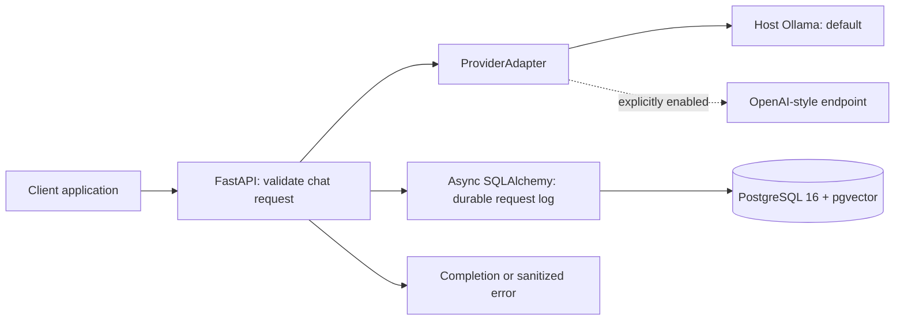

# LLM Gateway

Client applications should not have to implement provider-specific HTTP calls, usage
accounting, caching, routing, and failure handling individually. This project puts
those responsibilities behind a small OpenAI-style API and measures their effect
on latency, hypothetical cost, and answer quality.

**Current milestone: Phase 1 — core proxy and durable request logging.** Later
phases will add API keys and rate limiting, semantic caching, routing and fallback,
the evaluation harness, and a dashboard. No benchmark results exist yet.

## Architecture



The gateway and database run in Compose. Ollama runs on the host. Model inference
uses local resources and requires no paid API key. `pgvector` is installed by the
first migration; embeddings and vector queries arrive in Phase 3.

## Start locally

Prerequisites: Docker with Compose v2 and host-installed Ollama. Run these commands
from the project directory:

```sh
ollama pull qwen2.5:1.5b
cp .env.example .env
docker compose up
```

Before the last command, replace the password placeholder in both
`POSTGRES_PASSWORD` and `DATABASE_URL` in `.env`, using the same URL-safe password.
This workspace already includes an ignored `.env` with a generated random local
password; you can use it directly. `.env` is excluded from Git and Docker builds.

Ollama must be reachable from the container. Its default listen address is
`127.0.0.1`; when needed, set the **host Ollama process** to
`OLLAMA_HOST=0.0.0.0:11434` and restart it. Restrict access to the local Docker
network with your host firewall. The gateway defaults to
`OLLAMA_BASE_URL=http://host.docker.internal:11434`; Compose adds the host mapping
for Linux. See the [Ollama environment-variable instructions](https://docs.ollama.com/faq#how-do-i-configure-ollama-server).

Compose waits for PostgreSQL readiness, applies Alembic migrations, and starts the
gateway. The gateway binds to host loopback at port 8000. Open
[interactive API docs](http://localhost:8000/docs).

Send a request (use `curl.exe` in Windows PowerShell):

```sh
curl -i http://localhost:8000/v1/chat/completions -H "Content-Type: application/json" --data-binary @examples/chat.json
```

`DEFAULT_MODEL` applies when the request omits `model`. Change the example's model
if you pull a different one. Health checks test reachability without inference;
they do not confirm that a requested model has been pulled.

## Phase 1 API

| Route | Behavior |
| --- | --- |
| `POST /v1/chat/completions` | Non-streaming, text-only completion with OpenAI-style `choices` and `usage` |
| `GET /health` | Database and active provider reachability; 503 when degraded |
| `GET /metrics-summary` | Lifetime request count, reported token totals, and estimated cost |

Accepted generation options: `temperature`, `top_p`, `max_tokens`, `seed`, `stop`,
and `response_format: {"type": "text"\|"json_object"}`. Chat roles are `system`,
`user`, and `assistant`; `n` must be 1 and `stream` must be false. Unsupported or
invalid options return a sanitized OpenAI-style error with HTTP 400. The API is a
documented subset of the OpenAI chat protocol, not a full implementation.

Successful completions and provider failures include `X-Request-ID` matching the
database row and `X-Cache: BYPASS`. There is no cache in this phase. Provider
timeouts return 504, other upstream failures return 502, unexpected adapter errors
return 500, and database logging failures return 503. No retry or fallback runs yet.

`POST /admin/keys` and key authentication arrive in Phase 2. Phase 1 is intended
for local development, and Compose exposes only the gateway's loopback port.

## Configuration

All settings come from environment variables or `.env`, with environment variables
taking precedence. See `.env.example` for the minimal local setup.

| Setting | Purpose / default |
| --- | --- |
| `DATABASE_URL` | Required async SQLAlchemy URL: `postgresql+asyncpg://...` |
| `OLLAMA_BASE_URL` | `http://host.docker.internal:11434` |
| `DEFAULT_MODEL` | `qwen2.5:1.5b` |
| `PROVIDER_TIMEOUT_SECONDS` | HTTPX timeout per network operation: 120 seconds |
| `HEALTH_TIMEOUT_SECONDS` | Provider health request timeout: 5 seconds |
| `DEFAULT_PROVIDER` | `ollama`, or explicitly enabled `openai_compat` |
| `OPENAI_COMPAT_ENABLED` | `false` |
| `OPENAI_COMPAT_BASE_URL` | Optional endpoint URL including `/v1` |
| `OPENAI_COMPAT_API_KEY` | Optional bearer key; unnecessary for an unauthenticated local endpoint |
| `INPUT_COST_PER_1K`, `OUTPUT_COST_PER_1K` | USD per 1,000 tokens; both default to 0 |

The optional OpenAI-compatible adapter remains disabled by default. Selecting it
requires `OPENAI_COMPAT_ENABLED=true` and a base URL; otherwise startup fails
validation. Everything can run using only Ollama. No external service or key is
required by the tests.

## Design decisions and tradeoffs

- **Small provider contract.** `generate(prompt, model, params)` and `health()`
  keep provider-specific wire formats in the adapters. The Ollama adapter uses
  [`/api/generate`](https://docs.ollama.com/api/generate) with `stream=false` and
  provider-reported `prompt_eval_count` / `eval_count`. Its health check uses
  [`/api/tags`](https://docs.ollama.com/api/tags). HTTP clients are shared for the
  app lifetime and closed during shutdown.
- **Text transcript.** The requested prompt-based interface flattens messages to
  a role-labeled transcript, followed by an assistant cue. This preserves history
  text but does not guarantee native system-role precedence. The compatible
  adapter sends that transcript as one user message. A native message-based
  contract would improve fidelity if the project later requires it.
- **Commit before responding.** Every completion attempt, including validation
  errors and provider failures, commits one metadata row before returning its
  normal response. If logging fails, return 503. This trades availability and
  a database round-trip for durable accounting. A database outage, process crash,
  or forced cancellation can still prevent a row from being written.
- **No raw prompt logs.** SHA-256 hashes use canonical JSON of the ordered chat
  messages, including roles. Logs store no prompt or response text. These are
  correlation identifiers, not anonymization: low-entropy prompts can be guessed.
- **Separate async sessions.** Each request has its own SQLAlchemy session, in
  line with [SQLAlchemy's concurrency guidance](https://docs.sqlalchemy.org/en/20/orm/extensions/asyncio.html#using-asyncsession-with-concurrent-tasks).
  Requests never share mutable transaction state. Alembic owns schema changes;
  production does not call `create_all()`.
- **Explicit measurement boundaries.** Adapters measure outbound wall-clock
  latency, including transport overhead. The persisted `latency_ms` measures the
  gateway's time through validation and inference, before the log commit; it
  excludes commit latency and response transfer. Phase 5 will measure client-side
  end-to-end latency separately.
- **Honest usage accounting.** Token counts come from successful provider
  responses; missing or malformed counts cause an upstream error. Failed calls
  record zero because usage is unknown, so totals cannot capture partial upstream
  work. Monetary estimates use `Decimal` and a `NUMERIC(20,10)` database column.
  Phase 1 uses one input/output price pair; per-model prices arrive with evaluation.

## Tests and verification

Python 3.11 or newer:

```sh
python -m venv .venv
# Activate .venv using your shell's activation command.
python -m pip install -r requirements-dev.txt
python -m pip install --no-deps -e .
python -m ruff check .
python -m ruff format --check .
python -m pytest
```

`uv.lock` resolves dependencies; `requirements.txt` and `requirements-dev.txt`
export pinned runtime and test versions. Docker installs the pinned runtime set.
To refresh them with uv:

```sh
uv lock
uv export --no-dev --no-hashes --no-emit-project --output-file requirements.txt
uv export --extra dev --no-dev --no-hashes --no-emit-project --output-file requirements-dev.txt
```

The default suite covers mocked HTTP adapters, successful proxy calls, validation,
timeout/error logging, configuration, cost accounting, health, lifecycle cleanup,
and log-write failures. Proxy integration tests use async in-memory SQLite to
exercise real persistence and HTTP request handling. They do not verify
PostgreSQL-specific behavior. Offline Alembic tests inspect PostgreSQL upgrade
and downgrade SQL.

The `postgres` test additionally applies the real migration to an **empty
disposable PostgreSQL database with pgvector installed**, verifies the schema and
extension, and runs a fake-provider completion through PostgreSQL. Set
`TEST_DATABASE_URL=postgresql+asyncpg://...` and run
`python -m pytest -m postgres --no-cov`. This test leaves its data in that disposable
database and refuses a database containing existing tables.

Phase 1 verification on 2026-10-06:

| Check | Actual result |
| --- | --- |
| Ruff lint and formatting | Passed |
| Python 3.11.16 tests | 61 passed, 1 skipped |
| Line + branch coverage, excluding migrations | 96.96% (minimum enforced: 90%) |
| PostgreSQL migration SQL | Upgrade/downgrade generation passed |
| Live PostgreSQL + pgvector test | Skipped: no database supplied |
| Docker startup / live Ollama inference | Not run: Docker unavailable on the build machine |

The workspace sandbox disallows pytest's temporary-directory permissions; the
recorded run used `python -m pytest -p no:cacheprovider`. The application tests
themselves need no temporary files. CI setup arrives in Phase 6.

## Evaluation results

Pending Phase 5. No latency, quality, cache-hit, routing, or cost-savings benchmark
numbers are claimed. That phase will add the dataset, repeated seeded runs,
baseline comparisons, and a cache-threshold sweep; only actual harness outputs
will populate the results table.

## Phase 1 review

Review the availability tradeoff of committing logs before responding, the chat
transcript fidelity limitation, and the distinction between reported usage and
unknown usage on failed calls. The next milestone is API keys with hashed storage
and a concurrency-tested rate limiter. Work pauses at this milestone until `next`.
