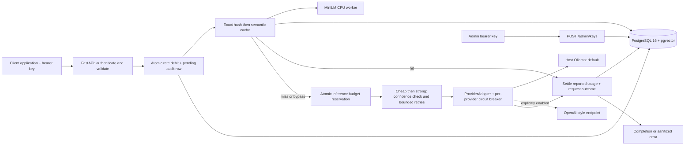

# LLM Gateway

Client applications should not have to implement provider-specific HTTP calls, usage
accounting, caching, routing, and failure handling individually. This project puts
those responsibilities behind a small OpenAI-style API and measures their effect
on latency, hypothetical cost, and answer quality.

**Current milestone: Phase 4 — model routing, fallback, retries, and circuit breakers.**
The core proxy, hashed keys, concurrent limits, token budgets, semantic cache,
and routing are implemented. Evaluation and the dashboard follow in later phases.
No end-to-end model benchmark results exist yet.

## Architecture



The gateway and database run in Compose. Ollama runs on the host. Model inference
uses local resources and requires no paid API key. `pgvector` is installed by the
first migration. The third migration adds a cache table with `vector(384)` embeddings.

## Start locally

Prerequisites: Docker with Compose v2 and host-installed Ollama. Run these commands
from the project directory:

```sh
ollama pull qwen2.5:1.5b
ollama pull qwen2.5:7b
cp .env.example .env
docker compose up
```

Before the last command, replace the password placeholder in both
`POSTGRES_PASSWORD` and `DATABASE_URL` in `.env`, using the same URL-safe password.
Also replace `ADMIN_API_KEY` with an independently generated random credential of
at least 32 characters. The example placeholder is rejected at startup. To
generate a URL-safe random value in Windows PowerShell:

```powershell
$rng = [Security.Cryptography.RandomNumberGenerator]::Create()
$bytes = New-Object byte[] 32
$rng.GetBytes($bytes)
[BitConverter]::ToString($bytes).Replace("-", "").ToLowerInvariant()
$rng.Dispose()
```

This workspace already includes an ignored `.env` with a generated random local
database password and a separate random admin key; you can use it directly without
copying the example over it. `.env` is excluded from Git and Docker builds.

Ollama must be reachable from the container. Its default listen address is
`127.0.0.1`; when needed, set the **host Ollama process** to
`OLLAMA_HOST=0.0.0.0:11434` and restart it. Restrict access to the local Docker
network with your host firewall. The gateway defaults to
`OLLAMA_BASE_URL=http://host.docker.internal:11434`; Compose adds the host mapping
for Linux. See the [Ollama environment-variable instructions](https://docs.ollama.com/faq#how-do-i-configure-ollama-server).

Compose waits for PostgreSQL readiness, applies Alembic migrations, and starts the
gateway. The gateway binds to host loopback at port 8000. Open
[interactive API docs](http://localhost:8000/docs).

The first semantic-cache request downloads the public MiniLM model from Hugging
Face without a token or paid API key. CPU PyTorch wheels are pinned; CUDA is not
required. Model files persist in Compose's `embedding_models` volume. This first
request has cold-start overhead; subsequent requests use local files. Set
`CACHE_ENABLED=false` for a proxy that never initializes the embedder. `/health`
checks the database and provider, not whether embedding weights have been loaded.

Create a client key using the admin credential from `.env` (use `curl.exe` in
Windows PowerShell):

```sh
curl http://localhost:8000/admin/keys -H "Content-Type: application/json" -H "Authorization: Bearer <ADMIN_API_KEY>" --data-binary @examples/create-key.json
```

Save the returned `api_key`; the server stores only its hash and returns the raw
value once. Use that client key for chat requests:

```sh
curl -i http://localhost:8000/v1/chat/completions -H "Content-Type: application/json" -H "Authorization: Bearer <CLIENT_API_KEY>" --data-binary @examples/chat.json
```

With routing enabled, omitting `model` selects cheap followed by strong if needed.
Edit `routing.yaml` to change the two model names. Health checks test reachability without inference;
they do not confirm that a requested model has been pulled.

## API

| Route | Behavior |
| --- | --- |
| `POST /v1/chat/completions` | Client bearer key; non-streaming text completion with OpenAI-style `choices` and `usage` |
| `GET /health` | Database and active provider reachability; 503 when degraded |
| `GET /metrics-summary` | Admin bearer key; lifetime request count, reported token totals, and estimated cost |
| `POST /admin/keys` | Admin bearer key; create a client key with per-key RPM and daily token limits |

Accepted generation options: `temperature`, `top_p`, `max_tokens`, `seed`, `stop`,
and `response_format: {"type": "text"\|"json_object"}`. Chat roles are `system`,
`user`, and `assistant`; `n` must be 1 and `stream` must be false. Unsupported or
invalid options return a sanitized OpenAI-style error with HTTP 400. The API is a
documented subset of the OpenAI chat protocol, not a full implementation.

Omitting `max_tokens` applies a finite default of 512 output tokens. Requests above
the configured maximum of 4096 are rejected before inference. In `/docs`, use
**Authorize** with the raw admin or client key appropriate for the endpoint.

Successful completions and provider failures include `X-Request-ID` matching the
database row and `X-Cache: HIT`, `MISS`, or `BYPASS`. Add `"cache": false` to a chat
request to skip both cache reads and writes. Provider
timeouts return 504 after bounded attempts, other upstream failures return 502,
unexpected adapter errors return 500, and database logging failures return 503.
When eligible provider circuits cannot accept a call, return 503 with `Retry-After`.
Success responses also include `X-Tier`, `X-Provider-Attempts`, and, when the
current request escalated, `X-Escalation-Reason`. The response's `model` names the
actual serving model. Cache hits report zero attempts and no current escalation.

Missing, unknown, or inactive client keys return 401 with `WWW-Authenticate:
Bearer`. Rate or budget rejections return 429 with a positive integer
`Retry-After` in seconds. Rejected chat requests are logged with a request ID,
including the authenticated key ID when known. Compose exposes only the gateway's
loopback port. Aggregate metrics require the admin key to protect cross-key data.

## Configuration

All settings come from environment variables or `.env`, with environment variables
taking precedence. See `.env.example` for the minimal local setup.

| Setting | Purpose / default |
| --- | --- |
| `DATABASE_URL` | Required async SQLAlchemy URL: `postgresql+asyncpg://...` |
| `OLLAMA_BASE_URL` | `http://host.docker.internal:11434` |
| `DEFAULT_MODEL` | `qwen2.5:1.5b`; default when routing is disabled |
| `PROVIDER_TIMEOUT_SECONDS` | HTTPX timeout per network operation: 120 seconds |
| `HEALTH_TIMEOUT_SECONDS` | Provider health request timeout: 5 seconds |
| `DEFAULT_PROVIDER` | `ollama`, or explicitly enabled `openai_compat` |
| `OPENAI_COMPAT_ENABLED` | `false` |
| `OPENAI_COMPAT_BASE_URL` | Optional endpoint URL including `/v1` |
| `OPENAI_COMPAT_API_KEY` | Optional bearer key; unnecessary for an unauthenticated local endpoint |
| `INPUT_COST_PER_1K`, `OUTPUT_COST_PER_1K` | USD per 1,000 tokens; both default to 0 |
| `ADMIN_API_KEY` | Random admin bearer credential, at least 32 characters; admin routes disabled when unset |
| `DEFAULT_MAX_OUTPUT_TOKENS` | 512 when the request omits `max_tokens` |
| `MAX_OUTPUT_TOKENS` | 4096 maximum accepted output allowance |
| `BUDGET_INPUT_TOKEN_PADDING` | 256 additional tokens reserved for provider prompt templates |
| `CACHE_ENABLED` | `true`; globally enables exact and semantic lookup |
| `CACHE_SIMILARITY_THRESHOLD` | `0.92`; inclusive cosine similarity threshold, between 0 and 1 |
| `CACHE_TTL_SECONDS` | `3600`; fixed expiry from generation time, not extended by hits |
| `CACHE_SHARE_ACROSS_KEYS` | `false`; explicitly opt in to sharing responses between keys |
| `EMBEDDING_CACHE_DIR` | Optional model directory; Compose sets a persistent writable volume |
| `ROUTING_ENABLED` | `true`; `false` restores single-call direct proxy behavior |
| `ROUTING_CONFIG_PATH` | `routing.yaml`; validated once at startup |

The optional OpenAI-compatible adapter remains disabled by default. Selecting it
requires `OPENAI_COMPAT_ENABLED=true` and a base URL; otherwise startup fails
validation. Everything can run using only Ollama. No external service or key is
required by the tests.

## Rate limits and daily budgets

Every key has its own token bucket: capacity equals `requests_per_minute`, and
tokens refill continuously at `requests_per_minute / 60` per second. It permits
an initial burst up to capacity; it is not a strict sliding-window counter.
Validated completion attempts debit the bucket. Provider failures consume the
request debit. With caching enabled, a request consumes RPM before lookup, even
if its miss later fails the budget check. With caching bypassed, RPM and budget
are checked together and a budget rejection consumes neither. Malformed and
unauthenticated requests are logged without an inference debit.

Admission runs inside a short PostgreSQL transaction. It locks the API-key row
with [`SELECT ... FOR UPDATE`](https://www.postgresql.org/docs/16/explicit-locking.html#LOCKING-ROWS),
then reads database wall-clock time and commits the request debit and `in_progress`
log. Cache lookup initially holds zero tokens. A miss reserves inference tokens
in a second short transaction under the same key lock, before calling the
provider. Bypassed requests reserve tokens during admission. The locks and
connections are released before CPU embedding work and inference. All workers use the same database
state; there is no process-local rate counter or lock.

Each attempt's allowance is UTF-8 prompt bytes + template padding + maximum output
tokens. Admission reserves it times the maximum attempts per tier times the
number of eligible tiers. The default auto route covers up to four calls: two
cheap and two strong. A request can be budget-rejected even if one successful
cheap call would have fit the remaining balance.
This conservative input estimate avoids needing a different tokenizer dependency
for each provider. Successful calls reconcile the hold against the provider's
actual input + output token counts across all completed calls, including a cheap
answer rejected by the heuristic. Failed attempts with unknown usage retain their
individual allowance; unused retry/fallback allowances are refunded at settlement.
Budget accounting and final log updates are
atomic and settlement is idempotent. `budget_tokens` records the charged allowance;
ordinary token columns record reported usage.

Failed calls with unknown usage retain an allowance for each started attempt.
A process crash leaves the full committed route hold and an `in_progress` row
because progress is unknown, rather than refunding potentially consumed
tokens. This favors budget safety over availability; no automatic same-day refund
or recovery endpoint is implemented. Calls finishing after midnight settle their
day of their inference reservation. If cache lookup crosses midnight, reservation
uses the new day. Calls already admitted still settle if the key is later marked
inactive.

Budgets reset at **00:00 UTC (05:30 India time)** using separate per-key, per-day
rows. Daily-budget `Retry-After` points to the next UTC reset.

An arbitrary provider's hidden tokenizer or prompt template can exceed the input
estimate, or a provider can ignore its output allowance. If reported usage pushes
the charged daily balance over budget, the gateway records all usage, returns
429, and rejects further inference while the balance exceeds the limit. Cache
hits can still succeed because they consume no inference tokens. Thus
concurrent reservations are bounded, but an exact upstream-consumption ceiling
cannot be guaranteed for every opaque provider. Increase padding for unusual
templates; this behavior has a dedicated overrun test.

## Routing, fallback, and recovery

`routing.yaml` defines two tiers and their attempt deadlines, retry policy,
provider circuits, and short-answer threshold. It contains no keys or provider
URLs. With routing enabled:

| Request model | Behavior |
| --- | --- |
| Omitted, `auto`, or `cheap` | Try cheap, then escalate to strong when needed |
| `strong` | Strong tier only; useful for the evaluation baseline |
| Any explicit model name | Direct request to the configured default provider; no confidence escalation |

All enabled routes have bounded retries and circuits, including direct requests.
Setting `ROUTING_ENABLED=false` disables those policies and uses one direct call.
The response always reports the actual model, not the requested alias. The
request log stores `tier`, `escalation_reason`, and the number of upstream
`attempts`, alongside usage and latency. Retries and fallback consume one RPM
allowance for the client request, not one per upstream attempt.

Cheap responses escalate when they are empty, shorter than the configured
12-character default, begin with a refusal pattern, or fail JSON-object parsing
when JSON was requested. Valid small JSON objects are exempt from the length
check. Completed low-confidence answers are not retried on cheap. Strong is the
final tier; it may return a short answer or refusal, but empty responses and
malformed requested JSON produce a sanitized error. These heuristics can send
correct short factual answers to strong, and do not establish factual correctness.

Provider errors/timeouts are retried with full jitter:
`uniform(0, min(max_delay, base_delay * 2**retry_index))`. Default attempts per
tier are 2, with 0.25-second base and 2-second maximum backoff. Unexpected bugs
and client cancellations are not retried. An attempt has a wall-clock deadline
using [Python's asyncio timeout](https://docs.python.org/3.11/library/asyncio-task.html#timeouts),
in addition to HTTPX's per-operation timeout. Slow local inference may require
larger tier deadlines. There is no separate whole-request deadline.

The [circuit breaker](https://learn.microsoft.com/en-us/azure/architecture/patterns/circuit-breaker)
opens after five consecutive completed transport failures on a provider. It
skips new upstream calls for 30 seconds, then admits exactly one half-open probe.
A successful probe closes it; failure or cancellation reopens it. Concurrent
state transitions use an asyncio lock and generation numbers prevent stale
completions reopening/closing a newer circuit. Breakers are per provider and
per process. Both Ollama tiers share a breaker; an Ollama outage can block both.
Different provider types have independent breakers. Restarts reset circuit state;
it is not synchronized across multiple gateway processes. `/health` checks the
default provider's reachability, not every tier's loaded model or breaker state.

To route a tier to the optional compatible adapter, explicitly enable it in
`.env`, set its URL, and use `provider: openai_compat` in YAML. Startup rejects
references to a disabled provider. No paid service is required: both committed
tiers use host Ollama. YAML uses safe loading and validated fields, and changes
take effect after restarting the gateway.

## Semantic cache behavior

Lookup first matches the structured prompt hash without computing an embedding.
On an exact miss, `sentence-transformers/all-MiniLM-L6-v2` embeds the full transcript
in a dedicated thread executor. PostgreSQL orders candidates by pgvector cosine
distance (`<=>`) and returns the nearest candidate meeting the configured
threshold. Model, normalized effective generation parameters (including JSON
mode), provider endpoint, conversation context, and unexpired TTL must all match.
Only the final user message may vary semantically; previous turns and system
instructions must match exactly. Changing the upstream URL changes the cache
namespace. If you replace a model's weights under the same name, clear its cache
or wait for TTL expiry.

For auto routes, cache lookup prefers a strong entry when available and checks
all eligible exact matches before computing one embedding for semantic lookup.
Rows store the actual serving model, provider, and tier. The routing policy is
part of the namespace, so strong-only and direct requests cannot receive a cheap
auto-route answer. Policy changes invalidate reuse. Migration 0004 adds provenance
fields; the new cache namespace also prevents reuse of older Phase 3 entries.
Cached strong responses are logged as strong hits without a new escalation.

The [MiniLM model card](https://huggingface.co/sentence-transformers/all-MiniLM-L6-v2)
documents 384-dimensional embeddings and truncation beyond 256 word pieces.
The gateway checks the actual tokenizer length and uses **exact matching only**
for overlong prompts and conversations ending in a non-user message. This avoids
semantic collisions caused by dropping a different suffix. Embedding errors
bypass caching; cache read/write errors do not discard successful inference.
Quota and audit database failures still return 503. Errors and empty answers
are never cached.

Cache hits return the saved text and finish reason with zero input/output usage,
zero cost, and no inference budget charge. These usage fields measure **new
inference**, not the historical token count of the saved answer. They consume
one RPM allowance. Cache rows store response text and embeddings; they can
contain sensitive information even though raw prompts are not stored. Each row
always records its owning API key. Keep `CACHE_SHARE_ACROSS_KEYS=false` unless
all clients may access each other's saved responses.

Expiry is fixed from storage, with expired rows removed lazily on successful
cache writes. Repeated concurrent misses use an upsert so one exact entry remains.
They may still perform duplicate inference; request coalescing is not implemented.
The vector search is exact rather than approximate. The scope index narrows
candidates, but high-volume corpora will need measured indexing and cleanup work.
Semantic similarity can confuse negation, numbers, or related questions requiring
different answers; the threshold is a tuning parameter, not a correctness proof.
Use `cache: false` for fresh stochastic output or questions requiring fresh data.
Phase 5 will measure the threshold/quality tradeoff before claiming savings.

## Design decisions and tradeoffs

- **Small provider contract.** `generate(prompt, model, params)` and `health()`
  keep provider-specific wire formats in the adapters. The Ollama adapter uses
  [`/api/generate`](https://docs.ollama.com/api/generate) with `stream=false` and
  provider-reported `prompt_eval_count` / `eval_count`. Its health check uses
  [`/api/tags`](https://docs.ollama.com/api/tags). HTTP clients are shared for the
  app lifetime and closed during shutdown.
- **Text transcript.** The requested prompt-based interface flattens messages to
  a role-labeled transcript, followed by an assistant cue. This preserves history
  text but does not guarantee native system-role precedence. The compatible
  adapter sends that transcript as one user message. A native message-based
  contract would improve fidelity if the project later requires it.
- **Commit before inference and responding.** Admission writes a pending row;
  completion updates that same row. Pre-admission rejections write a completed row;
  budget rejections after cache lookup finalize the already-admitted row.
  If admission fails to commit, the rate debit and budget hold roll back and no
  provider call runs. If final accounting fails, return 503 and keep the committed
  hold. Cancellation attempts to finalize its log without refunding unknown usage.
  A forced process exit can leave the row pending.
- **Random client keys.** Keys contain 256 bits of randomness; SHA-256 hashes are
  indexed for lookup. Slow password hashing is unnecessary for random tokens.
  Admin credentials live in `.env`, use constant-time comparison, and cannot be
  used as client keys unless independently registered. Existing Phase 1 logs
  retain nullable key IDs after the Phase 2 migration.
- **No raw prompt logs.** SHA-256 hashes use canonical JSON of the ordered chat
  messages, including roles. Logs store no prompt or response text. These are
  correlation identifiers, not anonymization: low-entropy prompts can be guessed.
  Cache response text is stored separately and has a configurable TTL.
- **Separate async sessions.** Each request has its own SQLAlchemy session, in
  line with [SQLAlchemy's concurrency guidance](https://docs.sqlalchemy.org/en/20/orm/extensions/asyncio.html#using-asyncsession-with-concurrent-tasks).
  Requests never share mutable transaction state. Alembic owns schema changes;
  production does not call `create_all()`.
- **Explicit measurement boundaries.** Adapters measure outbound wall-clock
  latency, including transport overhead. The persisted `latency_ms` measures the
  gateway's time through validation, admission, cache lookup, and inference,
  before the final log commit; it excludes settlement, cache writes, and response transfer.
  Phase 5 will measure client-side end-to-end latency separately.
- **Honest usage accounting.** Token counts come from successful provider
  responses; missing or malformed counts cause an upstream error. Failed calls
  record zero because usage is unknown, so totals cannot capture partial upstream
  work. Routing totals include every reported attempt, even rejected cheap output.
  Unknown attempts retain budget allowances but have no invented token usage or cost.
  Monetary estimates use `Decimal` and a `NUMERIC(20,10)` database column.
  One input/output price pair is supported; per-model prices arrive with evaluation.

## Tests and verification

Python 3.11 or newer:

```sh
python -m venv .venv
# Activate .venv using your shell's activation command.
python -m pip install -r requirements-dev.txt
python -m pip install --no-deps -e .
python -m ruff check .
python -m ruff format --check .
python -m pytest
```

`uv.lock` resolves dependencies; `requirements.txt` and `requirements-dev.txt`
export pinned runtime and test versions. Docker installs the pinned runtime set.
To refresh them with uv:

```sh
uv lock
uv export --no-dev --no-hashes --no-emit-project --emit-index-url --output-file requirements.txt
uv export --extra dev --no-dev --no-hashes --no-emit-project --emit-index-url --output-file requirements-dev.txt
```

The default suite covers mocked HTTP adapters, successful proxy calls, validation,
timeout/error logging, configuration, cost accounting, health, lifecycle cleanup,
and log-write failures, key creation/authentication, bucket refill, parallel bursts,
budget reservations, UTC resets, cancellation, and idempotent settlement. Proxy
tests also exercise cache scope, exact lookup, similarity thresholds, TTL,
bypass, failures, concurrent hits and cold misses, and executor behavior. Proxy
integration tests use independent connections to temporary SQLite databases.
SQLite's `BEGIN IMMEDIATE` serializes writers before reading limiter state;
production instead uses PostgreSQL row locks. These tests verify request-level
concurrency but do not prove PostgreSQL-specific locking. Offline Alembic tests
inspect PostgreSQL upgrade and downgrade SQL. Coverage explicitly traces both
threads and SQLAlchemy's greenlet bridge, as required by
[coverage.py's concurrency setting](https://coverage.readthedocs.io/en/latest/config.html#run-concurrency).

The `postgres` test additionally applies the real migration to an **empty
disposable PostgreSQL database with pgvector installed**, verifies the schema and
extension, exercises a 40-request fake-provider burst, and checks real pgvector
exact/semantic hits and TTL expiry with a fake embedder. Set
`TEST_DATABASE_URL=postgresql+asyncpg://...` and run
`python -m pytest -m postgres --no-cov`. This test leaves its data in that disposable
database and refuses a database containing existing tables.

Phase 2 verification on 2026-10-07 (machine-readable output in
[`reports/phase2-verification.json`](reports/phase2-verification.json)):

| Check | Actual result |
| --- | --- |
| Ruff lint and formatting | Passed |
| Python 3.11.16 tests | 104 passed, 1 skipped |
| Line + branch application coverage, excluding migrations | 100.00% (minimum enforced: 90%) |
| Concurrent burst, 2 app instances, fixed clock | 40 requests: 5 successful, 35 rejected at capacity 5 |
| Concurrent daily-budget holds | 12 requests: 1 admitted, 11 rejected while that call remained in flight |
| PostgreSQL migration SQL | Upgrade/downgrade generation passed |
| Live PostgreSQL + pgvector test | Skipped: no database supplied |
| Docker startup / live Ollama inference | Not run: Docker unavailable on the build machine |

The workspace sandbox disallows pytest's temporary-directory permissions; the
recorded run used `python -m pytest -p no:cacheprovider` with
`TEST_SQLITE_DIRECTORY` pointing to the workspace's `work/` folder. Normal test
runs use the operating system's temporary directory for SQLite files and remove
them after each test. The concurrency clock is frozen so refill during test
execution cannot make the expected burst size vary. No Ollama instance or API key
is required. CI setup arrives in Phase 6.

Phase 3 verification on 2026-10-07 (machine-readable output in
[`reports/phase3-verification.json`](reports/phase3-verification.json)):

| Check | Actual result |
| --- | --- |
| Ruff lint and formatting | Passed |
| Python 3.11.16 tests | 156 passed, 1 skipped |
| Combined line + branch application coverage, excluding migrations | 99.89% (784/784 lines; 111/112 branches) |
| Cached burst at an exhausted daily budget, fixed clock | 40 parallel requests: 5 hits served, 35 rate-limited at RPM capacity 5 |
| Concurrent cache-miss budget reservations | 12 parallel requests: 1 admitted to inference, 11 budget-rejected |
| PostgreSQL migration SQL | Upgrade through 0003 and downgrade generation passed |
| Real MiniLM CPU smoke check | 384-dimensional vectors; long-prompt guard passed |
| Live PostgreSQL + pgvector test | Skipped: no database supplied |
| Docker startup / live Ollama inference | Not run: executables unavailable on the build machine |

The separately recorded real-encoder smoke check is in
[`reports/phase3-embedding-smoke.json`](reports/phase3-embedding-smoke.json).
Its sample paraphrase similarity was 0.878683, below the default 0.92 threshold;
the unrelated pair scored 0.104830. These two examples validate the encoder,
not dataset quality or expected hit rate. The smoke script disabled only Hugging
Face's symlink capability probe to accommodate this Windows sandbox's temporary
directory restriction. Production code has no such patch. The pytest suite uses
fake embeddings and providers; it downloads no weights and requires no Ollama.

Phase 4 verification on 2026-10-07 (machine-readable output in
[`reports/phase4-verification.json`](reports/phase4-verification.json)):

| Check | Actual result |
| --- | --- |
| Ruff lint and formatting | Passed |
| Python 3.11.16 tests | 221 passed, 1 skipped |
| Combined line + branch application coverage, excluding migrations | 99.38% (1089/1091 lines; 192/198 branches) |
| Concurrent half-open circuit recovery | 40 callers: 1 probe admitted, 39 rejected |
| Parallel fallback requests at RPM capacity 3 | 12 requests: 3 served, 9 rate-limited; 6 upstream calls total |
| Parallel worst-case route budget reservations | 12 requests: 1 admitted, 11 budget-rejected while inference remained in flight |
| PostgreSQL migration SQL | Upgrade through 0004 and downgrade generation passed |
| Live PostgreSQL + pgvector test | Skipped: no database supplied |
| Docker startup / live Ollama inference | Not run: executables unavailable on the build machine |

Routing tests use scripted providers and controlled clocks/delays. They verify
decision logic and accounting, not model quality, production throughput, or latency
savings. The stored model, provider, tier, reason, and attempt count are checked
through fake-provider API integration tests. No Phase 4 benchmark numbers are claimed.

Full stack verification on 2026-10-08:

| Check | Actual result |
| --- | --- |
| Docker Compose build and startup | Passed; gateway and PostgreSQL running |
| Python 3.11.16 suite with real PostgreSQL + pgvector | 222 passed, none skipped |
| Combined line + branch application coverage | 99.38% (1089/1091 lines; 192/198 branches) |
| Live migrations through 0004, PostgreSQL concurrency, vector lookup, and TTL | Passed |
| Live Ollama inference | Passed with qwen2.5:1.5b and qwen2.5:7b |
| Exact cache, semantic case-variant cache, and bypass | Passed |
| Short-response escalation to strong model and JSON output | Passed |
| Authentication, budget 429 + Retry-After, sanitized upstream errors, and metrics | Passed |

Evidence: [`stack-verification.json`](reports/stack-verification.json),
[`stack-tests.xml`](reports/stack-tests.xml),
[`stack-coverage.xml`](reports/stack-coverage.xml), and
[`live-ollama-verification.json`](reports/live-ollama-verification.json).
The semantic smoke check changes casing to exercise real MiniLM and pgvector
with a different prompt hash. It does not establish paraphrase quality or a
dataset hit rate. All live checks are functional checks, not performance benchmarks.

`scripts/Test-Stack.ps1 -DatabaseOnly` builds Compose and runs the full suite
against an additional disposable PostgreSQL container. Without `-DatabaseOnly`,
it also runs the live gateway checks and requires both Ollama models. Existing
Compose data is preserved. The local workspace helper
`scripts/Start-LocalOllama.ps1` starts the downloaded portable Ollama runtime on
localhost and pulls the two models; it expects this workspace's `work/ollama` directory.

## Evaluation results

Pending Phase 5. No latency, quality, cache-hit, routing, or cost-savings benchmark
numbers are claimed. That phase will add the dataset, repeated seeded runs,
baseline comparisons, and a cache-threshold sweep; only actual harness outputs
will populate the results table.

## Phase 4 review

Review the two model sizes/deadlines in YAML, the short-answer/refusal heuristics,
conservative worst-case route budget holds, and the per-process circuit scope.
Cached answers retain serving-model provenance; reported usage includes all
completed attempts. The next milestone is evaluation. Work pauses here until `next`.
